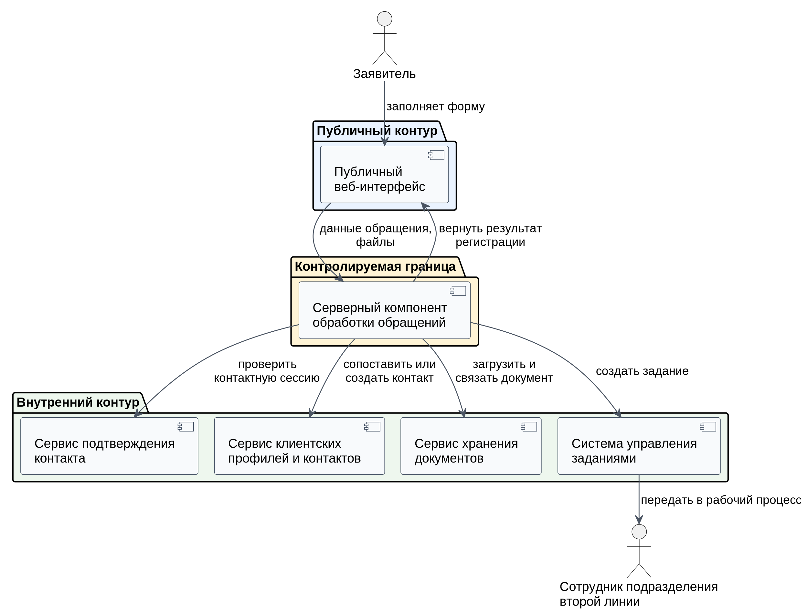
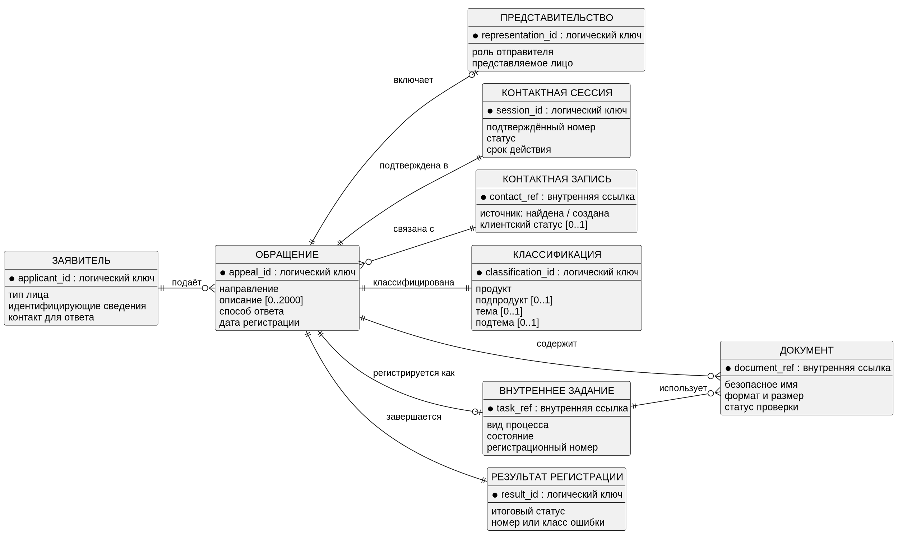
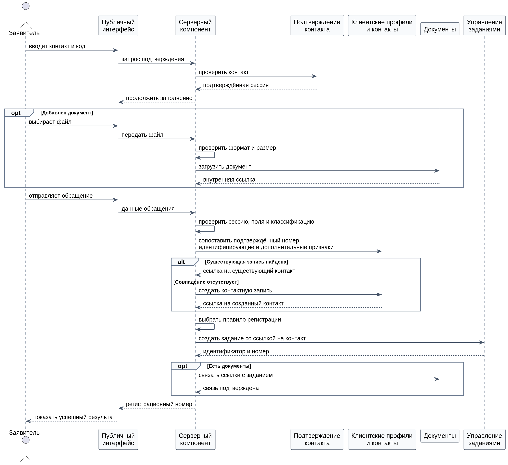
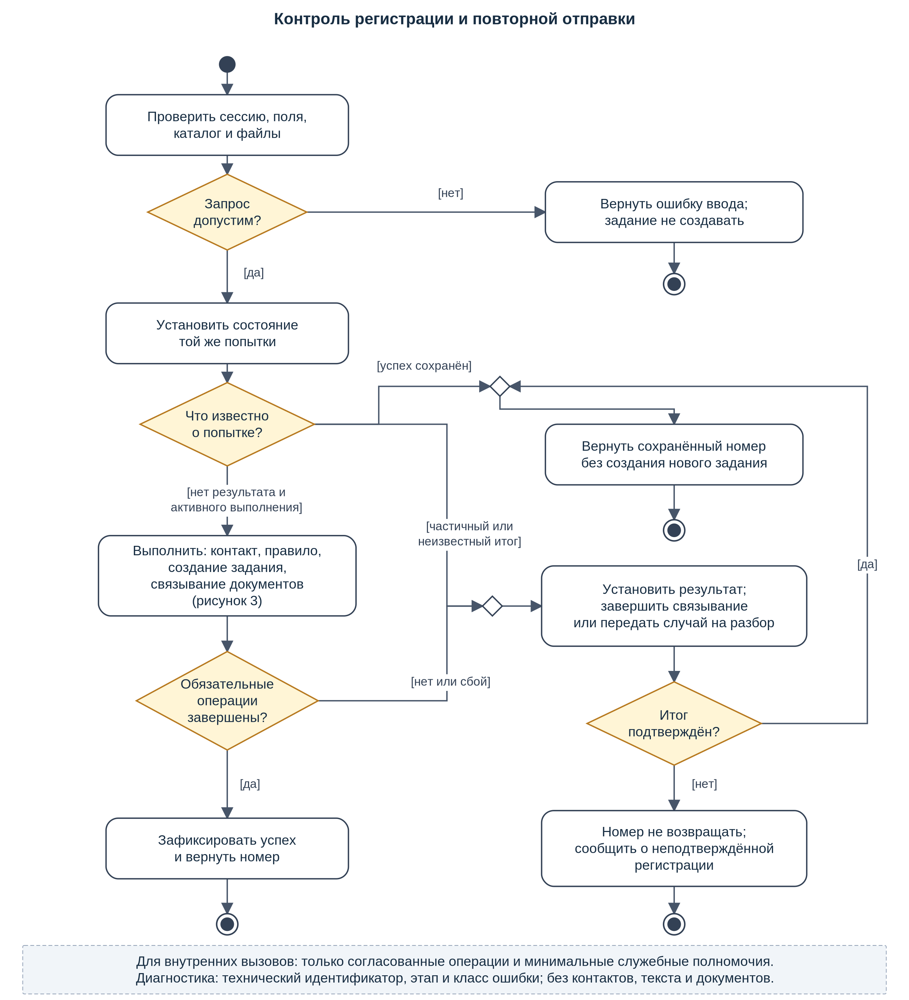
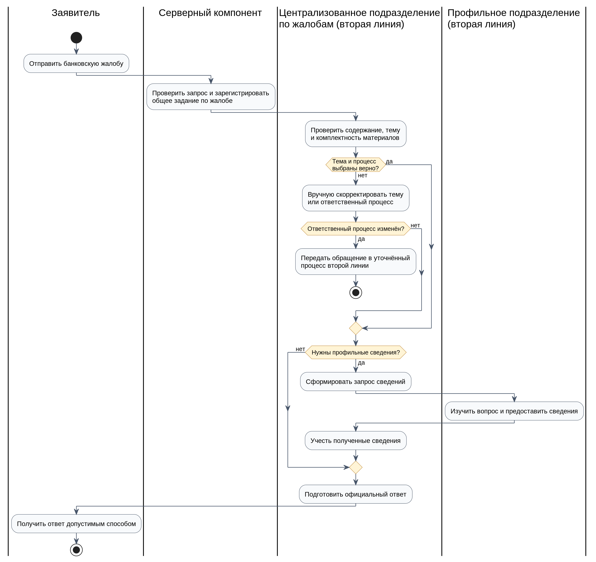
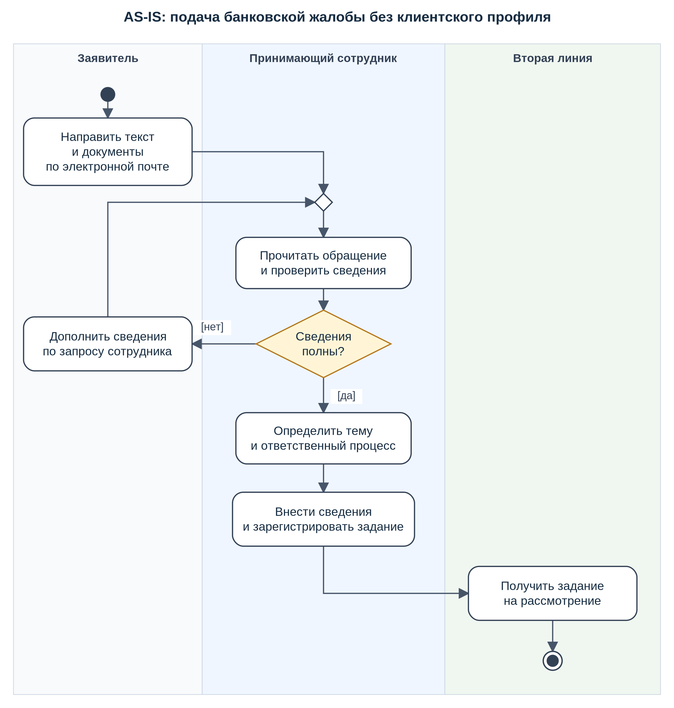
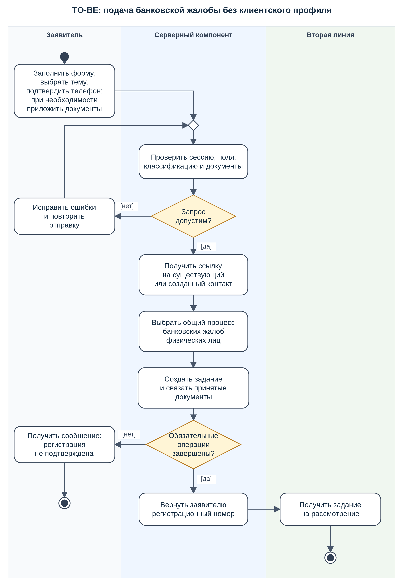

# ЛР 3 — проектирование информационной системы

**Тема ВКР:** «Проектирование и разработка информационной системы приёма, классификации и маршрутизации обращений в финансовой организации».

**Автор:** [dnazar01](https://github.com/dnazar01), индивидуальный проект.

**Вклад автора:** анализ процесса, формирование требований, проектирование логики, согласование интеграций и участие в приёмке. Промышленное программирование выполнялось командой разработчиков.

## 1. Предметная область и требования

### 1.1. Назначение и границы системы

До появления публичной формы заявитель без клиентского профиля мог направить обращение по электронной или обычной почте либо обратиться лично. Эти каналы принимали сведения в свободной форме. Сотрудник проверял, достаточно ли данных для рассмотрения, определял тему и переносил сведения во внутреннюю систему. Клиентский чат был доступен после входа в сервис обслуживания и потому не решал задачу такого заявителя.

Публичная форма объединяет подачу обращения в один последовательный сценарий. Заявитель выбирает тип лица и направление обслуживания, подтверждает телефон, указывает тему, описывает ситуацию и при необходимости прикладывает документы. Сервер проверяет запрос и регистрирует обращение в действующем процессе второй линии. Регистрационный номер возвращается после завершения обязательных операций.

При классификации заявитель последовательно выбирает значения из каталога, а сервер проверяет допустимость полученного пути. При маршрутизации по этому пути и другим признакам обращения определяется внутренний процесс регистрации. Банковская жалоба физического лица поступает в общее задание централизованного подразделения по жалобам второй линии. Для инвестиционных обращений и обращений юридических лиц используются собственные процессы второй линии. Сотрудник рассматривает содержание и готовит ответ.

Подтверждение телефона показывает доступ к номеру и позволяет продолжить сессию формы. Банковскую идентификацию и полномочия представителя оно не подтверждает. При регистрации сервер получает обязательную ссылку на существующую либо созданную контактную запись. Создание записи для неклиента сохраняет его статус и не даёт права получать сведения о другом лице.

В границы решения входят публичный веб-интерфейс и серверный компонент обработки обращений. Сервер взаимодействует с сервисом подтверждения контакта, сервисом клиентских профилей и контактов, сервисом хранения документов и системой управления заданиями. Внутреннее устройство этих систем, рабочее место сотрудника и процедура юридической проверки полномочий не проектируются.

В отчёте рассматриваются процессы, данные и взаимодействия компонентов системы. Программная реализация и результаты испытаний в эту лабораторную не включаются. Названия компонентов обобщены; внутренние адреса, контракты и реальные данные не публикуются.

### 1.2. Функциональные требования

Идентификаторы сохранены из требований ВКР. В последнем столбце указаны критерии проверки требований.

*Таблица 1 — Функциональные требования*

| ID | Требование | Как проверить выполнение |
|---|---|---|
| FR-01 | Открывать форму без обязательной банковской авторизации и принимать обращение независимо от наличия клиентского профиля | Заявитель без профиля проходит сценарий после подтверждения контакта; отсутствие профиля не становится причиной отказа |
| FR-02 | Поддерживать физическое лицо, юридическое лицо и представителя, а также выбор банковского или инвестиционного направления | После выбора типа заявителя и направления доступны соответствующие поля и каталог; для банковского обращения организации сервер выбирает внутренний бизнес-процесс |
| FR-03 | Перед регистрацией подтверждать номер телефона одноразовым кодом и проверять действующую сессию формы | При неподтверждённой или истёкшей сессии задание не создаётся; пользователю предложено подтвердить контакт |
| FR-04 | Сопоставлять заявителя с существующей записью по подтверждённому номеру, идентифицирующим сведениям и дополнительным признакам; при отсутствии совпадения создавать контактную запись | В обеих ветвях сервер получает внутреннюю ссылку на контакт до создания задания; регистрация неклиента продолжается |
| FR-05 | Предоставлять допустимый зависимый выбор продукта, подпродукта, темы и подтемы и проверять весь путь на сервере | Неизвестная комбинация отклоняется до создания задания; необязательные уровни не требуют фиктивных значений |
| FR-06 | Принимать описание длиной до 2000 символов и проверять ограничение в интерфейсе и на сервере | Описание в пределах лимита проходит проверку; превышение сопровождается ошибкой поля |
| FR-07 | Принимать вложения в форматах PDF, JPG/JPEG, PNG и TIFF/TIF размером не более 30 МБ на один файл | Каждый файл проверяется отдельно; неподдерживаемый формат и превышение размера отклоняются до загрузки во внутреннее хранилище |
| FR-08 | Выбирать правило регистрации по типу заявителя, направлению и проверенному классификационному пути | Банковская жалоба физического лица получает общий вид задания; инвестиционные обращения используют специализированные правила, а банковские обращения организаций — внутренний бизнес-процесс |
| FR-09 | Загружать принятые документы во внутреннее хранилище и связывать их с созданным заданием | После подтверждённой регистрации сотрудник получает связанные документы из задания; браузер не задаёт произвольную внутреннюю ссылку |
| FR-10 | Возвращать регистрационный номер только после завершения обязательных операций | Сбой создания задания или обязательного связывания документов не приводит к экрану успеха |
| FR-11 | Сохранять возможность ручного уточнения темы или ответственного процесса сотрудником второй линии | После корректировки сохраняются источник, срок рассмотрения, связь с исходным обращением и документы |
| FR-12 | Сохранять выбранный способ ответа и сведения, необходимые для проверки допустимости получателя | В задании различимы канал ответа и роли лиц; сведения доступны сотруднику для проверки перед направлением ответа |
| FR-13 | Сообщать об ошибках так, чтобы заявитель мог исправить ввод или безопасно повторить действие | Сообщения различают ошибки полей, сессии, файла и зависимости; технические подробности внутренних систем не раскрываются |

### 1.3. Нефункциональные требования

*Таблица 2 — Нефункциональные требования*

| ID | Требование | Как проверить выполнение |
|---|---|---|
| NFR-SEC-01 | Исключить прямое обращение публичного браузера к внутренним операциям профилей, документов и заданий | На компонентной модели и в интеграционных взаимодействиях все такие вызовы исходят от серверного компонента |
| NFR-SEC-02 | Ограничить межсервисный доступ согласованными операциями регистрации и минимальными служебными полномочиями | Для сервисной идентичности разрешены только необходимые операции; попытка выполнить несогласованную операцию отклоняется |
| NFR-SEC-03 | Минимизировать копирование персональных данных и исключить их открытые значения из диагностики | Взаимодействия используют внутренние ссылки; журналы не содержат телефонов, адресов, текста жалобы и содержимого файлов |
| NFR-REL-01 | Не создавать неконтролируемый дубликат при повторной отправке одной попытки | Для прежнего технического ключа и неизменного запроса возвращается результат или продолжается операция; изменение полей либо документов при прежнем ключе вызывает контролируемый конфликт без нового задания |
| NFR-REL-02 | Сохранять различие между полным успехом, частичным выполнением и ошибкой | Номер не возвращается до завершения обязательных шагов; незавершённые операции допускают восстановление или технический разбор |
| NFR-OBS-01 | Позволять установить этап и класс сбоя по техническому идентификатору без чувствительных данных | Для обращения прослеживаются обязательные операции и их исходы; диагностика не требует записи пользовательского содержимого |
| NFR-MNT-01 | Раздельно сопровождать пользовательский каталог и серверные правила с проверкой их совместимости | Каждый доступный конечный путь поддерживается правилом регистрации; неизвестное или неподдерживаемое сочетание отклоняется |
| NFR-UX-01 | Сохранять понятный пошаговый сценарий и связывать ошибку с исправляемым действием | Зависимые поля предлагают допустимые значения; сообщение указывает, какое поле, файл или подтверждение необходимо исправить |
| NFR-PRV-01 | Раздельно обрабатывать роли представителя и представляемого лица | Модель и запрос различают роли; подтверждённый телефон представителя не считается основанием для раскрытия сведений о представляемом лице |

## 2. Обзор нотаций и видов диаграмм

Рассмотрены восемь нотаций и видов диаграмм. Виды UML приведены отдельно, поскольку каждый из них описывает свою сторону системы. Использованы спецификации [UML 2.5.1](https://www.omg.org/spec/UML/2.5.1/About-UML) и [BPMN 2.0.2](https://www.omg.org/spec/BPMN/2.0.2/About-BPMN), описания [ER-моделирования](https://www.ibm.com/think/topics/entity-relationship-diagram) и [потоков данных](https://www.ibm.com/think/topics/data-flow-diagram), а также [документация модели](https://c4model.com/diagrams) C4.

*Таблица 3 — Назначение и применимость нотаций*

| Нотация или вид диаграммы | Что описывает | Сильные стороны и применимость к проекту |
|---|---|---|
| BPMN | Бизнес-процесс, события, задачи и обмен сообщениями между участниками | Удобна для границ организаций и регламентного процесса рассмотрения. Подробное описание всей процедуры выходит за границы публичной формы |
| ER, «воронья лапка» | Сущности, атрибуты, обязательность и множественность связей | Позволяет разделить контакт, клиентский статус, обращение и задание; выявляет обязательные связи до выбора физической схемы БД |
| DFD | Внешние участники, преобразования, хранилища и потоки данных | Помогает найти места передачи и хранения чувствительных сведений. Сама по себе не задаёт порядок вызовов и условия успеха |
| UML вариантов использования | Цели внешних участников и границы системы | Подходит для согласования состава функций с заказчиком. Не раскрывает порядок регистрации и обработку частичных сбоев |
| UML компонентов | Программные компоненты и зависимости | Показывает серверную границу доступа к внутренним функциям и распределяет ответственность за валидацию и интеграции |
| UML последовательностей | Сообщения между участниками во времени и альтернативные ветви | Показывает получение ссылки на контакт до задания и связывание документов до публичного успеха |
| UML деятельности | Действия, решения, потоки управления и зоны ответственности | Позволяет сопоставить ручной и целевой процессы, показать отказ, повтор и действия сотрудника |
| C4 | Архитектуру на уровнях контекста, контейнеров, компонентов и кода | Удобна для обзора окружения и изменения масштаба описания. Для данной работы уровень компонентов в значительной части повторил бы выбранную UML-модель |

## 3. Выбор нотаций для проекта

Для проекта выбраны четыре позиции: ER и три вида диаграмм UML. Их выбор связан с устройством регистрации. Нужно определить, кто выполняет каждое действие, в каком порядке сервер вызывает сервисы и какие данные связывают результат с исходным обращением. Процессная схема показывает ответственность участников, последовательность — порядок вызовов, ER — связи объектов после регистрации.

*Таблица 4 — Выбор моделей через требования*

| Нотация или вид диаграммы | Что моделируем | Связанные требования | Обоснование |
|---|---|---|---|
| UML компонентов | Публичный интерфейс, сервер, интеграционные зависимости и границу доверия | FR-03, FR-04, FR-09; NFR-SEC-01, NFR-SEC-02 | Позволяет проверить, что внутренние полномочия сосредоточены на сервере и не передаются браузеру |
| ER, «воронья лапка» | Заявителя, представительство, сессию, контакт, классификацию, обращение, задание, документы и результат | FR-02, FR-04–FR-06, FR-09, FR-10, FR-12; NFR-SEC-03, NFR-PRV-01 | Обязательная ссылка на контакт и отдельные роли лиц закрепляются в структуре связей; классификация отделяется от вида внутреннего задания |
| UML последовательностей | Подтверждение контакта, загрузку документов и регистрацию | FR-03–FR-10; NFR-SEC-01, NFR-REL-02 | Выявляет предусловия каждого вызова и момент, после которого допустим публичный номер |
| UML деятельности | AS-IS, TO-BE, контроль регистрации и работу второй линии | FR-01, FR-05, FR-08, FR-10, FR-11, FR-13; NFR-REL-01, NFR-REL-02, NFR-OBS-01, NFR-MNT-01, NFR-UX-01 | Позволяет показать ручные и автоматизированные действия в одной форме и отдельно разобрать ветви отказа и повтора |

BPMN потребовалась бы для подробного регламента рассмотрения с событиями и межорганизационными сообщениями. Для определения границ публичной формы достаточно показать действия сотрудников на диаграмме деятельности. DFD и C4 не добавляют представления, необходимого для проверки требований и отсутствующего в выбранных моделях.

## 4. Модели системы

Все семь диаграмм повторно использованы из согласованной ВКР. Рисунки сохранены без изменений; рядом размещены их редактируемые исходники.

### 4.1. Компоненты и граница доверия

*Рисунок 1 — Компонентная архитектура и граница доверия*

[Редактируемый исходник PlantUML](../../assets/design/architecture.puml).

Заявитель работает только с публичным веб-интерфейсом. Серверный компонент обработки обращений повторно проверяет данные, получает состояние контактной сессии и вызывает внутренние сервисы. Он же возвращает результат заявителю. На рисунке связь с системой управления заданиями обозначает создание задания, а связь с хранилищем — загрузку и последующее связывание документов.

Для компактности на диаграммах использованы сокращения. «Серверный компонент» обозначает серверный компонент обработки обращений. Подписи «Подтверждение контакта», «Клиентские профили и контакты», «Документы» и «Управление заданиями» относятся к соответствующим сервисам из раздела 1.1. «Вторая линия» обозначает ответственный процесс рассмотрения. Для банковской жалобы физического лица это централизованное подразделение по жалобам второй линии.

Внутренние операции вызывает сервер, что соответствует FR-03, FR-04, FR-09 и NFR-SEC-01. Он преобразует пользовательские поля в ограниченный набор команд. Браузер не передаёт имя внутреннего метода, вид задания или произвольную ссылку на документ. По NFR-SEC-02 сервисная идентичность сервера получает доступ только к согласованным операциям, необходимым для регистрации обращения.

### 4.2. Логическая модель данных

*Рисунок 2 — Логическая ER-модель в нотации «воронья лапка»*

[Редактируемый исходник PlantUML](../../assets/design/data-model.puml).

В центре ER-модели находится обращение. Оно связано с заявителем, контактной сессией, классификацией и обязательной контактной записью. Клиентский статус при этом может отсутствовать: модель допускает регистрацию неклиента по FR-01 и FR-04.

«Классификация» хранит выбранный путь. Подпродукт, тема и подтема могут отсутствовать, если ветвь заканчивается раньше. «Внутреннее задание» хранит вид процесса второй линии и регистрационный номер. Эти сущности разделены по FR-05 и FR-08: пользовательская подтема не является готовым внутренним адресом.

Связь обращения с заданием имеет кратность от нуля до одного. До подтверждённого создания внутреннее задание может отсутствовать; его наличие ещё не означает полного успеха. Результат регистрации хранится отдельно. Приложенные документы связываются с обращением и заданием (FR-09, FR-10). Связь документа с заданием соответствует завершённой регистрации. При частичном сбое временно загруженные файлы учитываются в контексте операции до связывания и не считаются уже зарегистрированными документами задания.

«Представительство» разделяет роли отправителя и представляемого лица. Способ ответа хранится в обращении и доступен сотруднику вместе с признаками ролей (FR-02, FR-12, NFR-PRV-01). Полномочия проверяет сотрудник второй линии.

Внутренние ссылки дают доступ к контакту и документам без копирования полного содержимого в каждое задание (NFR-SEC-03). ER-модель не воспроизводит таблицы промышленной БД. Ключи и кратности описывают логические связи, но не определяют СУБД или физическое размещение данных.

### 4.3. Последовательность регистрации

*Рисунок 3 — Последовательность успешной регистрации обращения*

[Редактируемый исходник PlantUML](../../assets/design/registration-sequence.puml).

Сначала сервер обращается к сервису подтверждения контакта. При добавлении документа он проверяет файл и получает внутреннюю ссылку. После окончательной отправки повторно проверяются сессия, поля и полный классификационный путь (FR-03, FR-05–FR-07).

Сопоставление заявителя имеет два исхода. Если существующая запись найдена, сервер использует её ссылку. Если совпадения нет, создаётся контактная запись. В обоих случаях ссылка должна быть получена до создания задания (FR-04). Полный набор идентифицирующих и дополнительных признаков в публичной модели не раскрывается.

Сервер выбирает правило регистрации и создаёт задание (FR-08). Внутренняя система возвращает номер, но заявитель ещё не получает подтверждение. Сначала сервер завершает обязательное связывание принятых документов и только затем возвращает публичный результат (FR-09, FR-10, NFR-REL-02). Группы `opt` обозначают необязательные документы: обращение без вложений не должно выполнять пустую загрузку.

Диаграмма показывает успешное выполнение и альтернативу поиска контакта. Ошибочные и повторные попытки раскрыты на рисунке 4. Внутренние технические идентификаторы остаются в серверных взаимодействиях; публичный результат содержит регистрационный номер и итоговый статус.

### 4.4. Контроль сбоев и повторной отправки

*Рисунок 4 — Контроль регистрации и повторной отправки*

[Редактируемый исходник diagrams.net](../../assets/design/registration-control.drawio).

В начале каждой попытки сервер проверяет действующую сессию и запрос. Недопустимый ввод приводит к сообщению об ошибке до создания задания (FR-03, FR-05, FR-13). Проверка «каталог» на рисунке охватывает полный путь и наличие поддерживаемого правила регистрации (NFR-MNT-01).

В действии «Установить состояние той же попытки» сервер сопоставляет технический ключ и контрольное представление запроса. При прежнем ключе и неизменном содержимом он возвращает сохранённый результат либо продолжает незавершённую операцию. Если с тем же ключом изменены поля или документы, возвращается контролируемый конфликт: прежний результат не применяется к другому содержимому, новое задание автоматически не создаётся (NFR-REL-01).

Если итог неизвестен или выполнение осталось частичным, сервер выясняет состояние внутренних операций. Затем он завершает связывание либо передаёт случай на технический разбор. Новое создание допускается только после подтверждения, что результата и активного выполнения этой попытки нет.

На рисунке 3 после окончательной отправки формы показаны получение контакта, выбор правила, создание задания и связывание документов. Допустимый файл мог быть загружен заранее; повторная отправка не должна произвольно менять его связь с обращением. Если обязательная операция завершилась сбоем или её исход неизвестен, сервер устанавливает результат. Подтверждённое завершение позволяет вернуть ранее созданный номер. Пока такого подтверждения нет, заявитель получает сообщение о неподтверждённой регистрации (FR-10, NFR-REL-02).

Для трассировки фиксируются технический идентификатор, этап и класс ошибки (NFR-OBS-01). Ограничение под диаграммой относится ко всем внутренним действиям. NFR-SEC-02 ограничивает полномочия вызовов, NFR-SEC-03 исключает из диагностики контакты, текст обращения и содержимое документов.

Техническое состояние сохраняет связь попытки с уже созданными объектами и незавершёнными операциями. При частичном сбое эта связь нужна для завершения регистрации или технического разбора. Номер возвращается только после подтверждённого завершения обязательных действий.

### 4.5. Работа второй линии после регистрации

*Рисунок 5 — Рассмотрение банковской жалобы физического лица*

[Редактируемый исходник PlantUML](../../assets/design/complaint-handling.puml).

После регистрации банковская жалоба физического лица поступает в централизованное подразделение по жалобам второй линии. Сотрудник проверяет содержание и комплектность материалов. Если неточно выбрана только тема, он исправляет тематический признак. Если неверно выбран сам процесс, обращение передаётся ответственному подразделению второй линии (FR-11). В обоих случаях сохраняется связь с исходным обращением и документами; корректировка не означает обязательного создания нового задания. Дальнейшая подготовка ответа на рисунке относится к обращениям, оставшимся в централизованном процессе.

Когда для ответа нужны профильные сведения, подразделение по жалобам запрашивает их у другого подразделения второй линии. Такой запрос не означает автоматической передачи ответственности за всю жалобу. Официальный ответ готовится в централизованном процессе. Сохранённые данные обращения используются для выбора допустимого получателя и канала ответа (FR-12, NFR-PRV-01).

Диаграмма раскрывает банковскую ветвь физического лица. Для других ветвей действует таблица 5; их специализированные регламенты в эту схему не включаются.

*Таблица 5 — Правила выбора процесса после серверной проверки*

| Тип заявителя и направление | Правило регистрации | Роль выбранной тематики |
|---|---|---|
| Физическое лицо, банковское направление | Общее задание централизованного подразделения по жалобам второй линии | Структурированный признак для работы сотрудника; не выбирает отдельное продуктовое подразделение для каждой жалобы |
| Физическое лицо, инвестиционное направление | Специализированный инвестиционный процесс второй линии по согласованному соответствию | Участвует в выборе вида задания вместе с направлением и типом заявителя |
| Юридическое лицо, инвестиционное направление | Отдельный специализированный инвестиционный процесс для организаций | Участвует в выборе по допустимому пути каталога организаций |
| Юридическое лицо, банковское направление | Собственный внутренний бизнес-процесс второй линии | Может завершаться продуктовой категорией без обязательной темы и подтемы |
| Обращение через представителя | Процесс выбирается по направлению представляемого обращения | Признак представительства не заменяет правило направления; полномочия проверяет сотрудник |

### 4.6. Прослеживаемость требований

*Таблица 6 — Связь требований с элементами моделей*

| Требования | Элементы моделей | Что можно проверить при чтении |
|---|---|---|
| FR-01, FR-02 | Вход заявителя на рисунке 1; заявитель и представительство на рисунке 2; ветви таблицы 5 | Клиентский профиль не является условием входа; роли и направления различаются |
| FR-03, FR-04 | Сессия и контактная запись на рисунке 2; подтверждение и альтернативная группа на рисунке 3 | Подтверждение контакта предшествует регистрации; ссылка на контакт обязательна и без профиля |
| FR-05, FR-06, FR-07 | Классификация и ограничение описания на рисунке 2; проверки запроса и файла на рисунках 3 и 4; ошибки на рисунке 7 | Проверяются полный путь, длина текста, формат и размер каждого файла; пользователь может исправить ввод |
| FR-08 | Выбор правила на рисунке 3 и таблица 5 | Пользовательский путь преобразуется в согласованный процесс, различающий направления |
| FR-09, FR-10 | Документ, задание и отдельный результат на рисунке 2; связывание до номера на рисунке 3; ветви исхода на рисунке 4 | Внутренний номер не становится публичным подтверждением до завершения обязательных действий |
| FR-11, FR-12 | Ручная корректировка и ответ на рисунке 5; представительство и способ ответа на рисунке 2 | Возможность исправления сохраняется; данные для проверки получателя не теряются |
| FR-13, NFR-UX-01 | Ошибка ввода и безопасный отказ на рисунке 4; возврат к исправлению на рисунке 7 | Ошибка имеет понятное продолжение; отказ не маскируется под успех |
| NFR-SEC-01, NFR-SEC-02 | Контуры и вызовы на рисунке 1; ограничение полномочий на рисунке 4 | Публичный контур не вызывает внутренние операции; сервер ограничен необходимыми функциями |
| NFR-SEC-03, NFR-OBS-01 | Ссылки на объекты на рисунке 2; правило диагностики на рисунке 4 | Этап и класс сбоя прослеживаются без записи пользовательского содержимого |
| NFR-REL-01, NFR-REL-02 | Ветви сохранённого, частичного и нового выполнения на рисунке 4 | Неизвестный итог не запускает новое создание; при прежнем ключе и изменённом запросе возвращается конфликт; успех отделён от частичного результата |
| NFR-MNT-01 | Проверка каталога на рисунке 4 и выбор правила на рисунке 3 | Видимый путь должен иметь поддерживаемое серверное правило; неизвестное сочетание отклоняется |
| NFR-PRV-01 | Представительство и клиентский статус на рисунке 2; граница действий сотрудника на рисунке 5 | Контактная сессия не заменяет проверку полномочий и допустимости раскрытия |

Модели согласованы по четырём основным объектам. Обращение содержит пользовательские сведения и классификацию. Контактная запись связывает эти сведения с заявителем. После выбора серверного правила создаётся внутреннее задание, а результат регистрации определяет, можно ли вернуть номер. Контактная запись при этом не требует обязательного клиентского профиля, а существующее задание ещё не подтверждает завершение всей регистрации.

## 5. AS-IS и TO-BE

### 5.1. Единый процесс для сравнения

Для сравнения выбран один процесс: подача банковской жалобы физическим лицом без действующего клиентского профиля, от отправки сведений до поступления внутреннего задания во вторую линию. Обе схемы выполнены как **UML деятельности**. В AS-IS заявитель использует электронную почту, в TO-BE — публичную форму. Клиентский чат и обращение через регулятора не смешиваются с этим процессом.

AS-IS показывает исходное состояние до проекта, TO-BE — процесс публичной подачи и регистрации обращения. Обе схемы заканчиваются поступлением задания во вторую линию; последующее рассмотрение показано отдельно на рисунке 5.

### 5.2. AS-IS: свободное обращение и ручная регистрация

*Рисунок 6 — AS-IS подачи банковской жалобы без клиентского профиля*

[Редактируемый исходник diagrams.net](../../assets/design/as-is.drawio).

Заявитель направляет текст и документы по электронной почте. Принимающий сотрудник читает обращение и проверяет, достаточно ли сведений для регистрации. Если данных не хватает, он запрашивает уточнение у заявителя. Получив сведения, сотрудник определяет тему и ответственный процесс, переносит данные во внутреннюю систему и регистрирует задание.

«Принимающий сотрудник» выполняет ручные действия на входе почтового канала. Эта роль не отождествляется с первой линией клиентского чата. Конкретная организационная принадлежность сотрудника на схеме не устанавливается.

Заявитель сам определяет состав письма. Поэтому сотрудник проверяет полноту сведений и формирует структурированную запись уже после отправки. Получение письма само по себе не заменяет регистрацию внутреннего задания.

### 5.3. TO-BE: структурированный ввод и серверная регистрация

*Рисунок 7 — TO-BE подачи банковской жалобы без клиентского профиля*

[Редактируемый исходник diagrams.net](../../assets/design/to-be.drawio).

Заявитель заполняет форму, выбирает тему, подтверждает телефон и при необходимости добавляет документы. Интерфейс помогает исправить формат и обязательные поля до отправки, а сервер повторяет значимые проверки. Ошибка возвращает пользователя к исправлению и не приводит к созданию задания (FR-03, FR-05–FR-07, FR-13).

После проверки сервер получает ссылку на контакт. Если совпадения с существующей записью нет, создаётся контактная запись, поэтому отсутствие клиентского профиля не прерывает процесс (FR-01, FR-04). Затем сервер выбирает общий процесс банковских жалоб физических лиц, создаёт задание и связывает принятые документы (FR-08, FR-09). Номер возвращается после завершения обязательных операций, а задание поступает во вторую линию. Если завершение не подтверждено, заявитель получает сообщение об этом. Порядок работы с техническим состоянием показан на рисунке 4 (FR-10, NFR-REL-02).

В целевом процессе структурированный ввод и серверная регистрация заменяют ручное чтение письма, перенос полей и первичный выбор процесса. Сотрудник второй линии по-прежнему рассматривает содержание и при необходимости исправляет тему или процесс, как показано на рисунке 5.

### 5.4. Обоснование перехода

*Таблица 7 — Изменения одного процесса при переходе к TO-BE*

| Участок процесса | AS-IS | TO-BE | Обоснование изменения |
|---|---|---|---|
| Сбор сведений | Свободное письмо; недостающие данные запрашиваются после чтения | Поля и каталог проверяются при заполнении и на сервере | Часть неполноты обнаруживается до регистрации; содержательная проверка сотрудником сохраняется |
| Работа с неклиентом | Данные переносятся сотрудником при ручной регистрации | Сервер получает существующую или создаёт новую контактную запись | Обязательная ссылка для задания формируется без требования клиентского профиля |
| Определение процесса | Сотрудник определяет тему и ответственный процесс | Сервер применяет согласованное правило банковской ветви | Для стандартного входа не требуется вручную формировать внутреннюю команду; ошибочная тема может быть исправлена позднее |
| Документы | Сотрудник переносит материалы письма в рабочий процесс | Сервер проверяет файлы и связывает их с заданием | Проверка вложения и подтверждение связи входят в последовательность регистрации |
| Наблюдаемый результат | Отправка письма и регистрация задания разделены ручной обработкой | Номер появляется после завершения обязательных операций | Заявитель получает явный результат регистрации, а не только передачи сообщения |
| Повтор и технический сбой | В выбранном ручном сценарии автоматическое установление результата не предусмотрено | Состояние предыдущей попытки проверяется до нового создания | Предусмотрена работа с неизвестным исходом и частичным выполнением без ложного успеха |

В TO-BE заявитель вводит сведения в общей форме, а сервер создаёт внутреннюю запись по проверенным данным. Сотруднику остаётся рассмотрение содержания. Это изменение видно в составе действий на схемах. Численное сокращение срока или трудозатрат не заявляется: для такого вывода нужны сопоставимые измерения исходного и целевого процессов.

## 6. Выводы

Модели описывают регистрацию от ввода сведений до передачи задания во вторую линию. За внутренние операции отвечает серверный компонент. Модель данных разделяет обращение, контакт, клиентский статус и задание; последовательность задаёт порядок вызовов. Диаграммы деятельности показывают, какие ручные действия заменяются серверными и как обрабатывается сбой.

При регистрации должны выполняться два условия: обращение получает ссылку на контакт, а публичный номер может быть возвращён только после подтверждённого завершения обязательных операций. Для неклиента может быть создана контактная запись, поэтому отсутствие профиля не нарушает первое условие. Внутренний номер задания не отменяет второго условия, пока документы ещё не связаны.

Сопоставление AS-IS и TO-BE показывает переход от ручной обработки свободного письма к структурированному вводу и серверной регистрации того же обращения. Содержательное рассмотрение, проверка полномочий и возможность исправления темы остаются у сотрудника. Проект не возлагает на каталог принятие юридического решения по жалобе.

Повторная отправка сопоставляется с предыдущей по техническому ключу и контрольному представлению запроса. Неизменный повтор использует ранее полученный результат или продолжает операцию; изменённый запрос с прежним ключом приводит к контролируемому конфликту. При частичном выполнении сохраняется связь с созданными объектами. Она используется для завершения регистрации или технического разбора; до завершения обязательных действий обращение не считается успешно зарегистрированным.